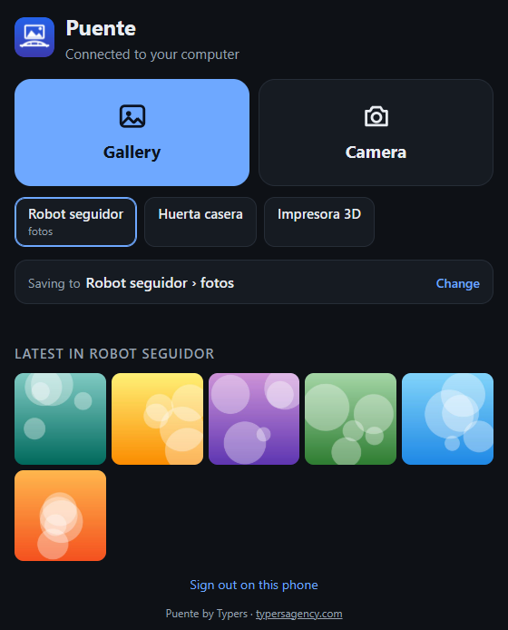
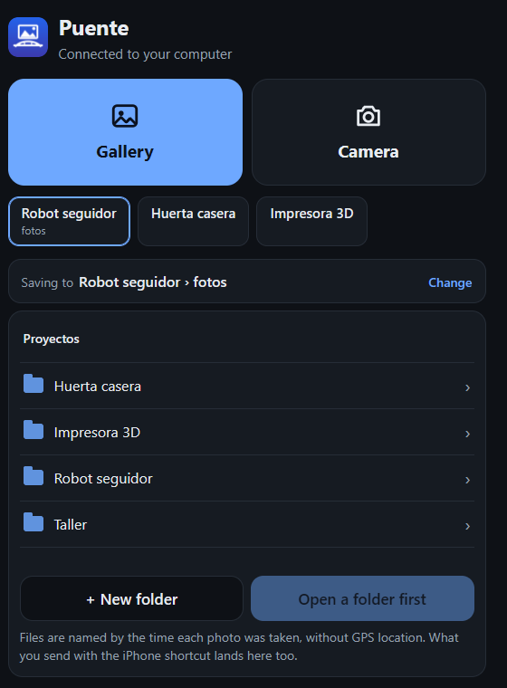

# Puente by Typers

**Manda fotos y videos del celular directo a la carpeta correcta de tu computador, por el Wi‑Fi de la casa. Sin cables ni nube.**

[English](README.md) · Licencia MIT · Python 3.9+ · Windows, macOS, Linux

<p align="center"> &nbsp; </p>

El Puente es un servidor pequeñito que corre en tu computador y una página que abres en el celular. Tocas **Galería** o **Cámara** y las fotos llegan a la carpeta que elegiste dentro de tus proyectos, con el nombre según la hora en que se tomaron y **sin la ubicación GPS**. El computador te avisa cuando llegan.

Lo hicimos para quienes construyen cosas con asistentes de IA como Claude Code: le tomas una foto a tu impresión 3D, a tu circuito o a tu tablero, y ya está en la carpeta del proyecto, donde tu asistente la puede ver.

## Qué hace

- **Galería y Cámara, a un toque.** Muchas fotos y videos de una vez, con barra de avance para cada uno.
- **Eliges la carpeta desde el celular.** Navegas por las carpetas de la carpeta compartida, creas una nueva y las recientes quedan a un toque.
- **Nombres ordenados.** Por ejemplo `2026-10-19_193438_MiProyecto_01.jpg`: la hora de la foto y el proyecto. Al armar el nombre se saltan las carpetas genéricas como `imagenes` o `fotos`.
- **Privacidad primero.** La ubicación GPS se borra al llegar (JPG, HEIC, PNG, WebP, MOV, MP4; metadatos EXIF, XMP y QuickTime), sin recomprimir la imagen. Sin nube, sin cuentas y sin internet: solo atiende a equipos de tu red local.
- **HEIC a JPG.** Las fotos HEIC del iPhone quedan con una copia JPG al lado del original.
- **Sin duplicados.** Si mandas la misma foto dos veces a la misma carpeta, no se guarda otra vez.
- **Avisos en Windows.** «Llegaron 3 fotos · MiProyecto › imagenes». Al tocar el aviso se abre la carpeta.
- **Español e inglés**, según el idioma del celular y del computador.

## Instalar

### Windows (lo más fácil)

1. Instala [Python 3.9 o más nuevo](https://www.python.org/downloads/windows/). En el instalador, marca **«Add python.exe to PATH»**.
2. Descarga este repositorio en ZIP (botón verde **Code** → **Download ZIP**) y descomprímelo, por ejemplo en `Documentos\Puente`.
3. Doble clic en **`Instalar en Windows.bat`**. Instala las librerías, crea los accesos directos, ofrece permitir el Puente en el firewall **solo en la red de tu casa** y lo enciende.
4. La primera vez te pregunta qué carpeta compartir (por ejemplo, la de tus proyectos). Desde el celular podrás elegir cualquier carpeta dentro de ella.

Si Windows pregunta por el firewall, marca **solo «Redes privadas»**.

El Puente vive en un ícono junto al reloj. Con clic ves el QR, el PIN y la llave del atajo. Con clic derecho abres tus carpetas recientes o apagas el Puente.

### macOS y Linux

```bash
python3 -m pip install --user -r requirements.txt
python3 puente.py
```

Se abre en el navegador una página con el QR y el PIN. Para compartir una carpeta distinta de Imágenes, crea `config.local.json` (ver [Configuración](#configuración)). Por ahora el ícono junto al reloj es solo para Windows; [se aceptan aportes](CONTRIBUTING.md).

Opcional: instala [ffmpeg](https://ffmpeg.org/) para ver miniaturas de los videos.

## Usar

1. El celular y el computador tienen que estar en el **mismo Wi‑Fi**.
2. Apunta la cámara del celular al código QR, abre el enlace y escribe el PIN.
3. Toca **Galería** o **Cámara**. Listo.
4. Para cambiar el destino, toca **Cambiar**, entra a la carpeta que quieras y toca **Guardar aquí**.

En el iPhone, desde Safari: **Compartir → Agregar a pantalla de inicio**, y queda un ícono del Puente como si fuera una app.

**Opcional, atajo del iPhone:** para mandar desde el botón Compartir de cualquier app (Fotos, WhatsApp, Archivos), sigue [docs/atajo-iphone.md](docs/atajo-iphone.md).

En Android también funciona: abre la dirección en Chrome. La conversión de HEIC solo aplica a fotos de iPhone.

## Configuración

`config.json` trae los valores por defecto. Lo tuyo va en `config.local.json`, que no va a git y gana sobre `config.json`:

```json
{
  "carpetas": { "raiz": "C:/Users/yo/Proyectos", "ocultar": ["viejos", "respaldos"], "inicial": "MiProyecto/imagenes" },
  "puerto": 8850
}
```

| Clave | Qué es |
|---|---|
| `carpetas.raiz` | La carpeta compartida. Nada se puede guardar fuera de ella. Vacía: tu carpeta Imágenes. |
| `carpetas.ocultar` | Nombres de carpetas que nunca se muestran. Las ocultas y las técnicas (`.git`, `node_modules`, `venv`…) nunca se muestran. |
| `carpetas.inicial` | La primera carpeta de destino, relativa a `raiz`. |
| `puerto` | Puerto (por defecto 8850). |
| `pin` | Se crea solo la primera vez: 8 números, que salen en la pantalla del computador. Puedes cambiarlo aquí (de 6 a 12 números). Al cambiarlo se cierra la sesión en todos los celulares. |
| `llave_atajo` | La llave del atajo del iPhone. Si la borras y reinicias, se crea otra; además, se cierra la sesión en todos los celulares. |
| `limite_imagen_mb`, `limite_video_mb` | Límites de tamaño (80 MB por foto, 4 GB por video). |
| `quitar_ubicacion` | Borrar la ubicación GPS (por defecto `true`). |
| `https` | HTTPS opcional con tu propio certificado: `cert`, `key` y `nombre` (la IP o el nombre del certificado). Ver [SECURITY.md](SECURITY.md). |
| `sesion_dias` | Cuánto dura abierta la sesión en un celular (30 días). |
| `espacio_minimo_mb` | Espacio libre que debe quedar en el disco (1024 MB). |
| `convertir_heic` | Hacer la copia JPG de las fotos HEIC (`true`). |
| `escuchar`, `ip` | Por dónde escucha (`0.0.0.0`) y la IP que sale en el QR (se detecta sola). |

Lo que va dentro de `carpetas` y `https` se mezcla clave por clave: en `config.local.json` solo pones lo que cambias.

## Seguridad

El Puente está hecho para **la red de tu casa, en la que confías**:
- Rechaza todo lo que no venga de tu red local.
- Pide PIN y bloquea por un rato una dirección después de 5 intentos equivocados (y toda la red después de 20).
- Solo acepta fotos y videos de verdad: revisa el contenido, no el nombre del archivo.
- Arma él mismo el nombre de cada archivo y nunca escribe fuera de la carpeta compartida.

Por defecto usa `http` dentro de tu red, así que alguien conectado **a tu mismo Wi‑Fi** podría ver el tráfico. Nunca lo expongas a internet: nada de reenvío de puertos ni túneles. Si quieres la conexión cifrada, activa HTTPS. Los detalles, y cómo reportar una vulnerabilidad, están en [SECURITY.md](SECURITY.md).

## Desarrollo

```bash
python -m pip install -r requirements.txt
python -m unittest discover -s pruebas -v
```

El código y los comentarios están en español, porque el Puente nació en Colombia. Los issues y pull requests son bienvenidos en español o en inglés. Ver [CONTRIBUTING.md](CONTRIBUTING.md).

## Licencia

[MIT](LICENSE) © 2026 [Typers](https://typersagency.com). Hecho en Colombia con Claude Code.
