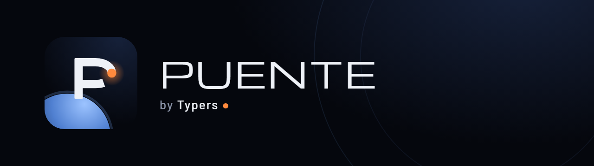

<p align="center"></p>

**Send photos and videos from your phone straight into the right folder on your computer — over your home Wi‑Fi, no cables, no cloud.**

[Español](README.es.md) · MIT License · Python 3.9+ · Windows, macOS, Linux

<p align="center"> &nbsp; </p>

Puente ("bridge" in Spanish) is a tiny server that runs on your computer and a web page you open on your phone. Tap **Gallery** or **Camera**, and the photos land in the folder you chose, inside your projects, named by the time they were taken and **without GPS location**. Your computer shows a notification when they arrive.

We built it for makers who work with AI assistants such as Claude Code: snap a photo of your 3D print, your circuit or your whiteboard, and it is already in the project folder where your assistant can see it.

## What it does

- **Gallery and Camera, one tap.** Send many photos and videos at once, with a progress bar for each one.
- **Choose the folder from your phone.** Browse the folders inside the shared folder, create a new one, and pick recent folders with one tap.
- **Tidy names.** `2026-10-19_193438_MyProject_01.jpg`: the time the photo was taken plus the project name. Generic folders such as `images` or `photos` are skipped when naming.
- **Privacy first.** The GPS location is erased as files arrive (JPG, HEIC, PNG, WebP, MOV, MP4; EXIF, XMP and QuickTime metadata), without re-compressing the image. No cloud, no accounts, no internet: Puente only answers devices on your local network.
- **HEIC to JPG.** iPhone HEIC photos get a JPG copy next to the original.
- **No duplicates.** If you send the same photo twice to the same folder, it is not stored again.
- **Notifications on Windows.** "Received 3 photos · MyProject › images". Click the notification to open the folder.
- **Spanish and English**, following the language of your phone and computer.

## Install

### Windows (easiest)

1. Install [Python 3.9 or newer](https://www.python.org/downloads/windows/). During setup, check **"Add python.exe to PATH"**.
2. Download this repository as a ZIP (green **Code** button → **Download ZIP**) and unzip it, for example in `Documents\Puente`.
3. Double-click **`Instalar en Windows.bat`**. It installs the libraries, creates the shortcuts, offers to allow Puente through the firewall **on your home network only**, and starts Puente.
4. The first time, Puente asks which folder to share (for example, your projects folder). From your phone you can pick any folder inside it.

If Windows asks about the firewall, tick **only "Private networks"**.

Puente lives in an icon next to the clock. Click it to see the QR code, the PIN and the shortcut key. Right-click it to open your recent folders or stop Puente.

### macOS and Linux

```bash
python3 -m pip install --user -r requirements.txt
python3 puente.py
```

A page with the QR code and the PIN opens in your browser. To share a folder other than your Pictures folder, create `config.local.json` (see [Settings](#settings)). The icon next to the clock is Windows-only for now. [Contributions are welcome](CONTRIBUTING.md).

Optional: install [ffmpeg](https://ffmpeg.org/) to get thumbnails for videos.

## Use

1. Your phone and your computer must be on the **same Wi‑Fi**.
2. Point your phone's camera at the QR code and open the link. Then type the PIN.
3. Tap **Gallery** or **Camera**. That's it.
4. To change the destination, tap **Change**, browse to a folder and tap **Save here**.

On iPhone, use Safari: **Share → Add to Home Screen** to get a Puente icon like an app.

**Optional — iPhone shortcut:** send from the Share sheet of any app (Photos, WhatsApp, Files). See [docs/shortcut-iphone.md](docs/shortcut-iphone.md).

Android works too: open the address in Chrome. HEIC conversion only applies to iPhone photos.

## Settings

`config.json` holds the defaults. Your own settings go in `config.local.json`, which is not in git and overrides `config.json`:

```json
{
  "carpetas": { "raiz": "C:/Users/me/Projects", "ocultar": ["old", "backups"], "inicial": "MyProject/images" },
  "puerto": 8850
}
```

| Key | What it is |
|---|---|
| `carpetas.raiz` | The shared folder. Nothing can be saved outside it. Empty means your Pictures folder. |
| `carpetas.ocultar` | Folder names that are never shown. Hidden and technical folders (`.git`, `node_modules`, `venv`…) are always hidden. |
| `carpetas.inicial` | The first destination folder, relative to `raiz`. |
| `puerto` | Port (default 8850). |
| `pin` | Created automatically on first run: 8 digits, shown on the computer. You can change it here (6 to 12 digits). Changing it signs out every phone. |
| `llave_atajo` | The key used by the iPhone shortcut. Delete it and restart to create a new one; this also signs out every phone. |
| `limite_imagen_mb`, `limite_video_mb` | Size limits (80 MB per photo, 4 GB per video). |
| `quitar_ubicacion` | Erase GPS location (default `true`). |
| `https` | Optional HTTPS with your own certificate: `cert`, `key` and `nombre` (the certificate's IP or name). See [SECURITY.md](SECURITY.md). |
| `sesion_dias` | How long a phone stays signed in (30 days). |
| `espacio_minimo_mb` | Free disk space that must remain (1024 MB). |
| `convertir_heic` | Make a JPG copy of HEIC photos (`true`). |
| `escuchar`, `ip` | Network interface to listen on (`0.0.0.0`) and the IP shown in the QR (detected automatically). |

The values inside `carpetas` and `https` are merged key by key, so `config.local.json` only needs what you change.

## Security

Puente is designed for a **home network you trust**. It refuses anything that does not come from your local network. It asks for a PIN and locks out an address after 5 wrong attempts (and the whole network after 20). It only accepts real photos and videos (it checks the file contents, not the name). It builds every file name itself and never writes outside the shared folder.

By default it uses plain `http` inside your network, so someone **on your same Wi‑Fi** could see the traffic. Never expose Puente to the internet: no port forwarding, no tunnels. For encrypted connections, enable HTTPS. Read [SECURITY.md](SECURITY.md) for the details and to report a vulnerability.

## Development

```bash
python -m pip install -r requirements.txt
python -m unittest discover -s pruebas -v
```

The code and comments are in Spanish (Puente was born in Colombia). Issues and pull requests are welcome in Spanish or English. See [CONTRIBUTING.md](CONTRIBUTING.md).

## License

[MIT](LICENSE) © 2026 [Typers](https://typersagency.com). Made in Colombia, built with Claude Code.
